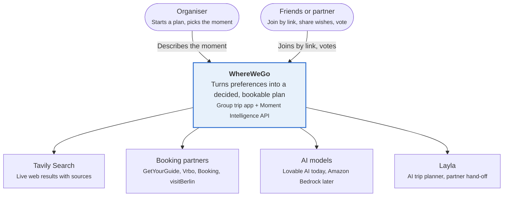
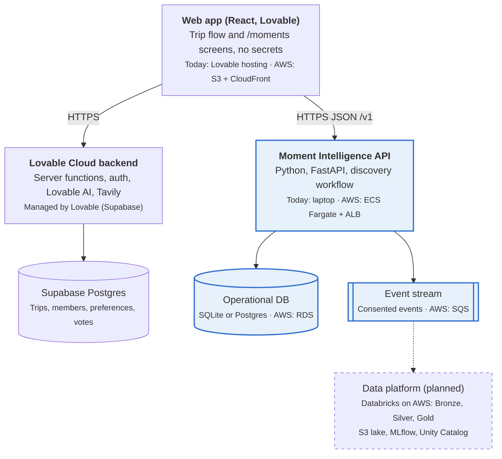
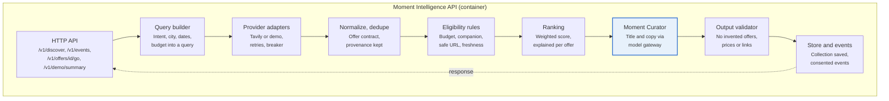
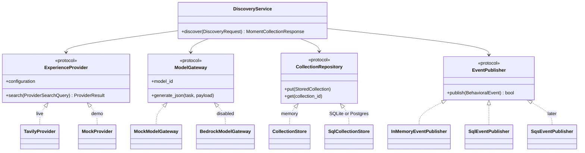

# WhereWeGo

**Product brand:** Create Your Memories · **Technical platform:** Moment Intelligence
**Core promise:** "Because the moments you share are what last."

> This README mirrors the team's shared onboarding doc ("WhereWeGo — Team onboarding"). It is written for everyone: leadership, sales and marketing, product, and AI engineers. Use [How to read this](#how-to-read-this) to jump to your part.

## Executive summary

WhereWeGo turns the endless "where should we go?" conversation into a decided plan and a booking click, in minutes. We built it at the Layla "€5K Build & Launch" hackathon (Berlin, 21–22 Nov 2026).

- **The problem:** groups and couples lose hours deciding. Planning tools serve one person, while the decision happens in a group chat where nobody earns anything.
- **The product:** people say what they want (who, mood, budget, dates). AI finds options from live, sourced web results, and deterministic rules rank them. Friends vote, and the winner links straight to booking sites.
- **Why now:** AI assistants are becoming the start of travel planning. Travel companies need to show up inside these decisions, and they increasingly treat AI as a growth engine, not only a cost cut.
- **How we make money:** commission on bookings through affiliate programs (GetYourGuide, Expedia/Vrbo, Booking.com via Travelpayouts, the visitBerlin WelcomeCard). Later: partnerships with AI planners such as Layla.
- **What exists today:** a live group-trip app on Lovable, plus our own production-grade discovery API (Moment Intelligence) with 60 automated tests and a strict "never invent a price" policy. Both run end to end on a laptop; cloud deployment waits for budget approval.

## How to read this

Each section is written for everyone, but you can skip to what your role needs.

| You are | Read first | You will get |
| --- | --- | --- |
| C-level, investor, judge | [Executive summary](#executive-summary), [Business model and growth](#business-model-and-growth), [Key decisions](#key-decisions) | What we sell, how it earns, the risks we control |
| Sales, marketing, partnerships | [Business model and growth](#business-model-and-growth), [C4 Level 1](#level-1-system-context), [Glossary](#glossary) | Who uses it, which partners we plug into, what we can promise customers |
| AI or software engineer (incl. junior) | [C4 Levels 2–4](#level-2-containers), [Run locally](#run-the-full-stack-locally), [How we work](#how-we-work), [Rules](#rules-that-never-break), [Engineering reference](#engineering-reference) | How the system is built, how to run it, where your code goes |
| Product, design | [Executive summary](#executive-summary), [C4 Levels 1–2](#architecture-c4-model), [Open questions](#open-questions-and-next-steps) | The user journey and what is live versus planned |

## Business model and growth

Our North Star is **Qualified Moment Discoveries**: a finished search that shows at least one suitable, sourced option. Behind it sits a simple loop, where every organiser brings friends for free and every decision ends in a booking click that can earn commission.

1. **Acquire organisers** through ads, communities and AI search visibility (people asking ChatGPT or Gemini "what to do in Berlin").
2. **Activate:** the organiser describes the moment; we return a collection in seconds.
3. **Spread:** friends join through one link and vote. Each organiser brings 3–5 users at zero ad cost.
4. **Convert:** the winning option links to a partner through a tracked click (`/go`), carrying our affiliate ID once approved. Friends who joined by link can follow it too.
5. **Learn:** consented events show which moods, budgets and partners convert, which improves ranking and partner choice.

What we report and optimise, in order of business value:

| Metric | Why it matters | Where it comes from today |
| --- | --- | --- |
| Cost per decided trip | The pitch number: ad spend that produced a real decision | Ad spend ÷ decided trips |
| Offer click-through rate | Intent to book, the revenue driver | `/moments/stats`, `GET /v1/demo/summary` |
| Friends per organiser | Free growth from the loop | Group trip app events |
| Qualified discoveries | North Star | Backend summary |
| Degraded / no-result rate | Quality and trust | Backend summary |

Clicks are never reported as bookings; confirmed bookings only come from affiliate network reports.

### Affiliate model: how the click earns

Our revenue model is affiliate commission: a partner pays us when a click from WhereWeGo ends in a completed booking. **Status today: the code is ready, no partner is approved yet, so no click is monetised and revenue is zero.**

- **What happens on a click:** `/go` always sends the user to the stored source page of the offer. If that page belongs to an approved partner, our partner ID and a random click ID are added to the link; every other link is left untouched.
- **Who approves a partner:** a human, by adding the partner to `AFFILIATE_RULES` after the programme has accepted us and its terms are reviewed. Empty rules (the default) mean nothing is tagged. Details: [ADR-013](docs/adr/ADR-013-affiliate-links-at-redirect.md).
- **What we promise:** commission never influences ranking, AI models never see or write links, and every monetised click is recorded as `monetised: true` with its click ID so bookings in the partner report can be matched back later.
- **What is still missing:** approved partner IDs, an "we may earn a commission" notice in the frontend, the import of partner booking reports (`affiliate_conversion_confirmed`), and a partner catalogue with verified prices ([#5](https://github.com/chadha/WhereWeGo/issues/5)). Web-search results only earn when they happen to be partner pages.

## Where everything lives

| What | Where | Notes |
| --- | --- | --- |
| Backend repo (FastAPI, docs, ADRs) | this repo | `main` is the truth; work on branches + PRs |
| Architecture | [docs/architecture.md](docs/architecture.md) | AWS target + current slice (§9) |
| Decisions | [docs/adr/](docs/adr) | ADR-001 to ADR-013 |
| Data contracts | [docs/data-contracts.md](docs/data-contracts.md), [contracts/schemas/](contracts/schemas) | Pydantic is the source of truth; schemas are generated |
| Local demo guide | [docs/local-fullstack-demo.md](docs/local-fullstack-demo.md) | Run steps + 2-minute demo script |
| Team onboarding | [docs/team/](docs/team) | Workstreams, issue map, Claude Code kickoff prompts |
| Agent brief | [AGENTS.md](AGENTS.md), [CLAUDE.md](CLAUDE.md) | Read automatically by Codex / Claude Code |
| Frontend (Lovable) | [WhereWeGo AI project](https://lovable.dev/projects/5bd19370-cc27-471c-8631-8f82f976d664) | Routes `/moments`, `/moments/stats`, plus the trip flow |
| Live app | [where-we-go-app.lovable.app](https://where-we-go-app.lovable.app) | Group trip flow; `/moments` needs the local API |
| Frontend repo | `wherewego-web` (to be created, [#3](https://github.com/chadha/WhereWeGo/issues/3)) | Lovable → Settings → GitHub → Connect |

## Key decisions

We build production-grade from day one but deploy nothing that costs money without explicit approval. **Production-ready architecture from day one, but gradual, controlled deployment.**

| Decision | Why | ADR |
| --- | --- | --- |
| AWS is the cloud (was Azure) | Team choice; only the cloud changed, every rule stayed | [011](docs/adr/ADR-011-aws-as-cloud-platform.md) |
| Modular monolith, Python + FastAPI | One team, one product; split only with evidence | [001](docs/adr/ADR-001-modular-monolith.md) |
| Python-controlled workflow, no agent swarm | Testable, bounded cost and loops | [002](docs/adr/ADR-002-python-controlled-agent-orchestration.md) |
| Models only behind a gateway (mock now, Bedrock later) | Swap or compare models without touching logic | [003](docs/adr/ADR-003-bedrock-behind-model-gateway.md) |
| Prices, eligibility, ranking are deterministic code | LLMs must never decide prices, availability or links | [004](docs/adr/ADR-004-deterministic-eligibility-and-ranking.md) |
| PostgreSQL as source of truth (SQLite locally) | Clear relational data; no vector DB yet | [005](docs/adr/ADR-005-postgresql-operational-source-of-truth.md) |
| Events via a queue (SQS later), consent-aware | Analytics never slows a request; GDPR | [006](docs/adr/ADR-006-queue-based-async-event-ingestion.md), [008](docs/adr/ADR-008-consent-aware-anonymous-analytics.md) |
| Databricks medallion lakehouse on AWS | Learn from demand; governance via Unity Catalog | [007](docs/adr/ADR-007-databricks-medallion-lakehouse.md) |
| No live provider data or scraping without approval | Affiliate and API terms first | [009](docs/adr/ADR-009-no-live-provider-data-without-approval.md) |
| No deployment without explicit approval; CI never deploys | Predictable spend | [010](docs/adr/ADR-010-no-deployment-without-explicit-approval.md) |
| Tavily as a web-search provider (basic, max 5 results) | Real, sourced ideas before partner deals; price/availability stay "unknown" | [012](docs/adr/ADR-012-tavily-web-search-provider.md) |
| Affiliate links are added only at the `/go` redirect, from human-approved rules | Revenue without letting AI or web results write links; off by default | [013](docs/adr/ADR-013-affiliate-links-at-redirect.md) |

Product decisions: we optimise for decided trips and offer clicks over features; Vrbo/Expedia and GetYourGuide are the main booking links; Layla is pitched as a partner ("Layla plans for one, we bring the group").

## Architecture (C4 model)

We describe the system at the four [C4](https://c4model.com) zoom levels, from the business view down to the code. Level 1 is for everyone; Levels 3–4 are mainly for engineers.

### Level 1: System context

WhereWeGo is one system between two kinds of people and four kinds of outside services. We never take payments; we hand users to partners and earn commission.



**In plain words:** people tell us what they want, we search the web and rank options, and partners handle the booking. **For engineers:** every outside service sits behind an adapter, and none can be called without credentials and approval (ADR-009, ADR-010).

### Level 2: Containers

The product runs as one web app, two backends and three data stores; every container we own has a named AWS home for later.



**In plain words:** the live trip app runs fully on Lovable, and our own API handles Moment discovery and keeps its data and analytics separate. **For engineers:** the API calls Tavily and the model gateway (Level 1); events go to a queue so analytics never slow a request (ADR-006); the AWS labels are a plan, not a deployment (ADR-010, ADR-011).

### Level 3: Components

One discovery request passes eight components in a fixed order; only the Curator touches an AI model, and its words are checked before anyone sees them.



**In plain words:** like an assembly line with quality control at the end: search, clean, filter, score, describe, check, save. If any step fails, the customer gets an honest "we couldn't search right now" instead of made-up ideas. **For engineers:** the order lives in `application/discovery.py`; each step has a timeout or fallback; Tavily is capped at basic search and 5 results (ADR-012); the ranking weights are in `ranking/scoring.py` (ADR-004).

### Level 4: Code

The workflow depends on four small interfaces, so we can add a partner, a model or a database by writing one adapter, without touching the business rules.



**In plain words:** like plugs and sockets: Tavily, Bedrock or Postgres plug into the same socket, so swapping a supplier is a small, low-risk change. **For engineers:** code is under `src/moment_intelligence/`; adapters are picked in `apps/api/app/main.py` (`build_container`) from environment settings; contracts live in `domain/contracts.py` and are shared by every box above. Start new work by implementing one of these interfaces and adding a test. Partner adapters (Fever, Viator, Groupon, GetYourGuide, visitBerlin) are tracked in [#5](https://github.com/chadha/WhereWeGo/issues/5).

## Run the full stack locally

Two terminals and about 10 minutes; without a Tavily key everything runs on a clearly labelled demo catalogue.

1. Backend:

   ```bash
   git clone https://github.com/chadha/WhereWeGo && cd WhereWeGo
   cp .env.example .env    # optional: TAVILY_API_KEY=tvly-... (ask Chadha; never commit it)
   ./scripts/run_local.sh  # http://localhost:8000/docs
   ```

2. Frontend (after the Lovable → GitHub sync exists, [#3](https://github.com/chadha/WhereWeGo/issues/3)):

   ```bash
   git clone https://github.com/chadha/wherewego-web && cd wherewego-web
   npm install
   echo "VITE_API_BASE_URL=http://localhost:8000" > .env.local
   npm run dev             # http://localhost:8080/moments
   ```

3. Checks before every PR (backend): `ruff check . && ruff format --check . && mypy && pytest -q`.

Alternative backend with PostgreSQL: `docker compose up --build` (not yet tested on a real Docker host). Full demo script: [docs/local-fullstack-demo.md](docs/local-fullstack-demo.md).

## How we work

GitHub is the single source of truth: every task is an issue, every change is a PR, and nobody (human or Claude Code) pushes to `main`.

- **Task board:** GitHub Issues, labelled `ws:backend`, `ws:frontend` or `ws:data`. Pick an issue, assign it to yourself, comment "starting" before writing code.
- **Branches:** `be/<issue>-<slug>`, `fe/<issue>-<slug>`, `data/<issue>-<slug>`. Small PRs, one issue each, `Closes #<n>` in the body.
- **PR checklist:** tests and lint pass locally, real results pasted in the PR (never "should pass"), docs updated when behaviour changes, no secrets.
- **Review and merge:** a different person or agent reviews; Chadha merges. Rebase on `main` before asking for review.
- **Shared files need a heads-up:** `domain/contracts.py`, `pyproject.toml`, `AGENTS.md`, `CLAUDE.md`, `docs/architecture.md` and ADRs. Change them only in a PR labelled `contract-change`, and regenerate schemas with `python scripts/export_schemas.py`.
- **Lovable rules:** Lovable writes to `main` of `wherewego-web`. Claude Code works there only on branches, pulls before starting, and never edits the same screen Lovable is changing.
- **Claude Code sessions:** each one reads `CLAUDE.md` (which imports `AGENTS.md`) automatically, works only in its workstream's folders, and starts with the kickoff prompt in [docs/team/agent-kickoff.md](docs/team/agent-kickoff.md).
- **Handoffs:** when you stop, leave a comment on the issue: what is done, what is next, what is blocked.

## Workstreams and owners

Three Claude Code sessions each own one workstream with its own folders, so they never edit the same files; humans pair with them and review.

| Workstream | Claude Code session | Owns (folders) | First issues |
| --- | --- | --- | --- |
| Backend core | Agent A (`be/`) | `src/moment_intelligence/**`, `apps/api/**`, backend `tests/`, `migrations/` | [#4](https://github.com/chadha/WhereWeGo/issues/4) Alembic, [#5](https://github.com/chadha/WhereWeGo/issues/5) provider adapters, [#6](https://github.com/chadha/WhereWeGo/issues/6) Intent Agent, [#7](https://github.com/chadha/WhereWeGo/issues/7) admin auth |
| Frontend and demo | Agent B (`fe/`) | `wherewego-web` repo; `docs/local-fullstack-demo.md` | [#8](https://github.com/chadha/WhereWeGo/issues/8) Playwright e2e, [#9](https://github.com/chadha/WhereWeGo/issues/9) demo polish |
| Data and evaluation | Agent C (`data/`) | `evaluation/**`, `data_platform/**`, `docs/evaluation.md` | [#10](https://github.com/chadha/WhereWeGo/issues/10) dataset, [#11](https://github.com/chadha/WhereWeGo/issues/11) ranking eval, [#12](https://github.com/chadha/WhereWeGo/issues/12) local medallion pipeline |
| Product, pitch, merges | Chadha | Issues, PR merges, Lovable prompts, slides | [#3](https://github.com/chadha/WhereWeGo/issues/3) Lovable → GitHub sync; Tavily and affiliate keys; demo numbers |

## Rules that never break

These protect users, our budget and the pitch; a PR that breaks one is not merged.

- Never invent a price, availability, booking confirmation, affiliate link or review. Unknown stays `unknown`.
- LLMs phrase things; deterministic code decides eligibility, ranking, prices and links.
- No secrets in code, logs, the frontend or chat. Keys live in `.env` locally and Secrets Manager later.
- No cloud spend without explicit approval: no AWS resources, no Databricks compute, no Bedrock, no `terraform apply`. CI runs tests only.
- No scraping, and no provider APIs without credentials plus a terms review.
- Analytics only with consent; random session IDs; clicks are never counted as bookings.
- Report real test output. Never claim a result that was not measured.

## Open questions and next steps

The next step that unblocks everyone is the Lovable → GitHub sync; the rest can run in parallel.

- [ ] Chadha: connect Lovable to GitHub (`wherewego-web`) so the frontend runs locally ([#3](https://github.com/chadha/WhereWeGo/issues/3))
- [ ] Chadha: share the Tavily key with the team privately (not in Slack, not in Git)
- [ ] Decide whether the group trip flow moves onto our FastAPI backend later, or stays on Lovable Cloud
- [ ] Apply to Travelpayouts, GetYourGuide Partner, Expedia Travel Creator Program; when approved, add each partner to `AFFILIATE_RULES` in `.env` using the link format from its dashboard
- [ ] Frontend: show "we may earn a commission when you book" next to booking links before any partner is switched on
- [ ] Decide how a friend's click can be counted: today it is redirected but not recorded, because only the organiser's session gave analytics consent
- [ ] Agents A, B, C: start their first issue using [docs/team/agent-kickoff.md](docs/team/agent-kickoff.md)
- [ ] Before any AWS step: cost estimate and approval per [infra/approval-gates.md](infra/approval-gates.md)

## Engineering reference

### API endpoints

Interactive docs at http://localhost:8000/docs when the API runs.

| Endpoint | Purpose |
|---|---|
| `POST /v1/discover` | Validated `DiscoveryRequest` → `MomentCollectionResponse` |
| `GET /v1/collections/{id}` | Fetch a generated collection |
| `GET /v1/offers/{offer_id}?collection_id=` | Offer details |
| `POST /v1/events` | Client events: `offer_viewed`, `offer_clicked`, `collection_viewed` |
| `GET /v1/offers/{offer_id}/go?collection_id=&session_id=` | Records `offer_clicked` (with `click_id` and `monetised`) and redirects to the stored source URL only, tagged for an approved affiliate partner when `AFFILIATE_RULES` matches. Works for any session holding the collection link; only the organiser's consented session is recorded |
| `GET /v1/health/live`, `/v1/health/ready` | Health (reports provider mode and whether affiliate links are on, never secrets or IDs) |
| `GET /v1/demo/summary` | Aggregate demo numbers (disable with `DEMO_SUMMARY_ENABLED=false`) |

```bash
curl -s localhost:8000/v1/health/ready
curl -s -X POST localhost:8000/v1/discover \
  -H 'content-type: application/json' \
  -d @contracts/examples/discovery_request.json
python scripts/export_schemas.py   # regenerate contracts/schemas/*.json and openapi.json
```

### What the discovery slice guarantees

At most five `basic` Tavily results per discovery; results deduplicated; source URL, title, search timestamp and query kept as provenance; price and availability always `unknown` for web results (never parsed from page text); no affiliate or booking URLs invented (offers in API responses never carry one; tagging happens only at `/go`, only for hosts in `AFFILIATE_RULES`); unsafe URLs dropped; bounded retries, timeouts, a circuit breaker and an honest fallback when search fails; consent-aware, idempotent events. Details: [docs/architecture.md §9](docs/architecture.md#9-current-implementation-local-vertical-slice).

### Documentation map

| Document | Contents |
|---|---|
| [docs/architecture.md](docs/architecture.md) | Target architecture on AWS, layers, service choices, agent workflow, data platform |
| [docs/data-contracts.md](docs/data-contracts.md) | Versioned contracts: DiscoveryRequest, IntentResult, Offer, BehavioralEvent, MomentCollectionResponse |
| [contracts/examples/](contracts/examples) | JSON examples of every contract |
| [docs/adr/](docs/adr) | Architecture Decision Records ADR-001 to ADR-013 |
| [docs/security-and-privacy.md](docs/security-and-privacy.md) | Security architecture, threat model, GDPR data minimization |
| [docs/evaluation.md](docs/evaluation.md) | How we prove the AI is reliable: intent, ranking, operations, business metrics |
| [docs/growth-and-ai-discoverability.md](docs/growth-and-ai-discoverability.md) | SEO / AEO / GEO content structure and AI crawler readiness |
| [docs/roadmap.md](docs/roadmap.md) | Phases, acceptance gates and Sprint 1 checklist |
| [infra/](infra) | AWS IaC layout (Terraform, plan-only), cost estimates, approval gates, resource inventory |

### Stack

Python 3.12+, FastAPI, Pydantic, SQLAlchemy (+ Alembic, [#4](https://github.com/chadha/WhereWeGo/issues/4)), PostgreSQL/SQLite, httpx, pytest, Ruff, mypy (strict). Planned on AWS: Amazon Bedrock behind the model gateway, Amazon SQS, Amazon S3, Databricks on AWS (Unity Catalog, Delta, MLflow), Terraform. Versions are not pinned by guesswork.

## Glossary

| Term | In plain words |
| --- | --- |
| C4 model | Four zoom levels of architecture: context (who uses it), containers (apps and databases), components (parts inside one app), code (classes) |
| Moment Collection | The answer we return: a titled set of up to 5 experience ideas with sources and reasons |
| Deterministic | Same input, same output, decided by code rules and tests, never by an AI's guess |
| Model gateway | One door for every AI model call, so we can swap models (mock today, Amazon Bedrock later) without touching the product |
| Tavily | A web search service built for AI; we use its cheapest "basic" search, max 5 results |
| Provenance | Where an offer came from: source page, title, search query and time |
| Affiliate link | A partner link that pays us a commission when someone books |
| Tracked click (`/go`) | Our redirect that records a click, then sends the user to the real source page, with our partner ID added when the page belongs to an approved partner |
| Click ID | A random code added to each partner link so a booking in the partner's report can be matched to our click; it contains nothing about the person |
| Consent-aware events | Analytics we only store when the user said yes; no names or emails |
| ADR | Architecture Decision Record: a one-page note of a decision and why |
| Medallion (Bronze/Silver/Gold) | Data layers: raw events, cleaned events, business-ready tables |
| CORS | Browser rule that decides which websites may call our API |
| North Star metric | The one number that best predicts long-term value: Qualified Moment Discoveries |

## Changelog

Updated with every change to the team onboarding doc; newest first.

| Date | Change |
| --- | --- |
| 2026-11-21 | Affiliate business model: `/go` tags approved partner links from `AFFILIATE_RULES` (off by default), friends can follow shared links, ADR-013 added |
| 2026-11-21 | README now mirrors the team onboarding doc, with the C4 diagrams as Mermaid; engineering reference kept at the end |
| 2026-11-21 | Onboarding rewritten for mixed audiences: executive summary, reading guide by role, business model and growth, full C4 architecture (Levels 1–4), glossary, changelog |
| 2026-11-21 | First version: context, links, decisions, architecture, local run, workflow, workstreams (issues #3–#12), rules, open questions |
