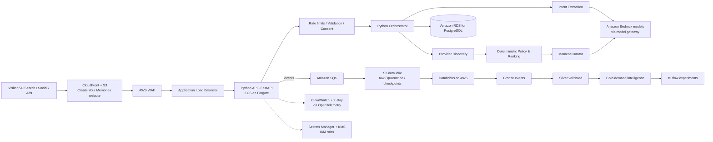
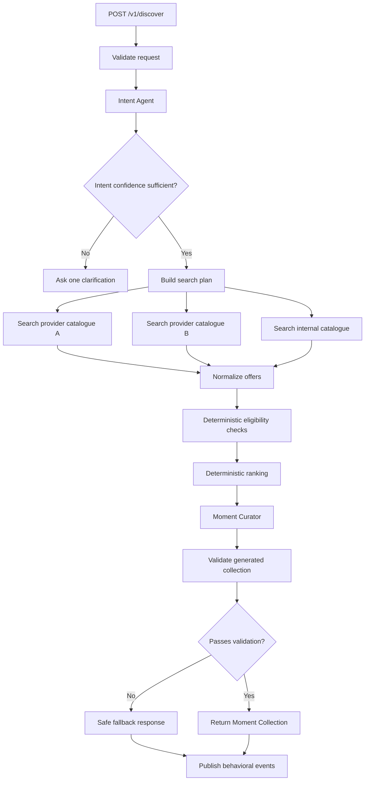

# Architecture: Moment Intelligence on AWS

## 1. Architecture decision

**Python-first orchestration + Amazon Bedrock models (behind a provider-neutral gateway) + Databricks Lakehouse on AWS.**

The original design targeted Azure (Microsoft Foundry, Azure Databricks). The only change is the cloud: AWS. Every principle, contract, rule and gate stays the same. See [ADR-011](adr/ADR-011-aws-as-cloud-platform.md).

The architecture separates three kinds of responsibility:

| Layer | Responsibility |
|---|---|
| Experience layer | Understands the visitor and presents experiences and memories |
| Intelligence layer | Understands intent and orchestrates the agents |
| Data intelligence layer | Analyses demand and improves recommendations and business decisions |

We do **not** start with an autonomous multi-agent swarm. We start with Python-controlled orchestration. The LLM helps understand the request and phrase the results, while prices, budget, eligibility, affiliate links and ranking constraints stay deterministic and testable.

## 2. Target architecture

The runtime request path is separated from analytics: the API never waits for the data platform.



Not every service must exist on day one. The Databricks pipeline can be ready in code and configuration, but its execution stays **disabled** until the cost is approved.

## 3. AWS service choices

| Capability | Choice | Why |
|---|---|---|
| Frontend | Amazon S3 + CloudFront | Static/prerendered React hosting with a global CDN |
| API + orchestration | Amazon ECS on AWS Fargate behind an ALB | Python container, managed scaling, no servers or clusters to run |
| Agent framework | Plain Python orchestration (asyncio + typed steps) | Code-first, testable, provider-neutral (see ADR-002) |
| Models | Amazon Bedrock | Managed model access, swappable behind our gateway (see ADR-003) |
| Operational database | Amazon RDS for PostgreSQL | Offers, providers, configuration |
| Event buffering | Amazon SQS | Decouples requests from analytics |
| Lake storage | Amazon S3 | Raw and curated data |
| Data platform | Databricks on AWS | Lakehouse, Unity Catalog, MLflow, analytics |
| Secrets | AWS Secrets Manager + AWS KMS | Credentials and encryption keys |
| Identity | IAM roles (ECS task roles), IAM Identity Center for admins | Passwordless service authentication, least privilege |
| Observability | Amazon CloudWatch + AWS X-Ray via OpenTelemetry (ADOT) | Logs, traces, metrics |
| Edge protection | AWS WAF + rate limiting | Abuse protection on public endpoints |
| Cost guardrails | AWS Budgets + Cost Anomaly Detection | A cost owner and budget alert for every resource |
| Infrastructure as Code | Terraform (plan-only in CI) | Repeatable, reviewable, version-controlled |

### Azure → AWS mapping (from the original design)

| Original (Azure) | Now (AWS) |
|---|---|
| Azure Static Web Apps / CDN | S3 + CloudFront |
| Azure Container Apps | ECS on Fargate + ALB |
| Microsoft Agent Framework | Python-controlled orchestration (framework optional, only where it adds clear value) |
| Microsoft Foundry models | Amazon Bedrock behind the model gateway |
| Azure Database for PostgreSQL | Amazon RDS for PostgreSQL |
| Azure Storage Queue | Amazon SQS |
| ADLS Gen2 | Amazon S3 |
| Azure Databricks | Databricks on AWS |
| Key Vault | Secrets Manager + KMS |
| Managed Identity / Entra ID | IAM roles / IAM Identity Center |
| Application Insights + Azure Monitor | CloudWatch + X-Ray (OpenTelemetry) |
| Bicep / `az deployment what-if` | Terraform / `terraform plan` |

**Why PostgreSQL?** Provider, offer, price, location, category and affiliate status have clear relationships. We need neither a graph database nor a vector database at the start.

**Why a queue?** The visitor never waits for Databricks. The API publishes an event and returns quickly; analysis happens asynchronously.

**Why not EKS (Kubernetes)?** We have no need for Kubernetes operations in this product yet. We do not add platform complexity before a workload justifies it.

**Why Fargate?** Containers keep the API and orchestration portable. Measure cold-start and latency before production traffic.

## 4. Backend design and API

Python + FastAPI inside a container. Business logic stays independent of AWS SDKs as far as possible so it can be tested locally and re-hosted later.

| Endpoint | Method | Responsibility |
|---|---|---|
| `/v1/discover` | POST | Create a personalized discovery |
| `/v1/collections/{id}` | GET | Retrieve a Moment Collection |
| `/v1/offers/{id}` | GET | Offer details and verification |
| `/v1/events` | POST | Record behavioral events |
| `/v1/health/live` | GET | Liveness |
| `/v1/health/ready` | GET | Dependency readiness |
| `/v1/admin/providers` | GET/POST | Protected provider management |
| `/v1/admin/insights` | GET | Protected demand analytics |

Admin endpoints require authentication and authorization. Public discovery endpoints need rate limits, request validation and abuse protection.

Contracts are defined once as Pydantic models (single source of truth); OpenAPI and JSON Schema are generated from them so frontend, backend and Databricks agree on the meaning of the data. See [data-contracts.md](data-contracts.md).

## 5. Agent orchestration

**Stateful sequential workflow with controlled parallel discovery.** Agents do not talk to each other freely: we control the execution graph, and every step has an input, output, timeout and retry policy.



| Component | LLM? | Allowed actions |
|---|---|---|
| Intent Agent | Yes | Interpret natural language into a validated intent |
| Search Planner | Optional | Suggest provider search terms and categories |
| Discovery adapters | No | Query approved APIs/catalogues |
| Eligibility engine | No | Enforce price, date, location and policy rules |
| Ranking engine | No (initially) | Score eligible offers deterministically |
| Moment Curator | Yes | Write emotional collection titles and grounded explanations |
| Output validator | No | Check schema, price claims, URLs and source references |

### A. Intent Agent
- Extract companion, occasion, mood, budget, dates and constraints.
- Return JSON matching `IntentResult`.
- Do not invent missing values; distinguish user-provided from inferred values.
- Return `missing_information` when a required detail is absent. If there is important ambiguity, ask the user **one** question only.
- Never ask for names, phone numbers or personal identity.
- `confidence` is not a guarantee that the LLM understood correctly: it is tested against labeled evaluation data.

### B. Discovery: provider adapters

```python
class ExperienceProvider:
    async def search(self, query: ProviderSearchQuery) -> list[Offer]:
        raise NotImplementedError
```

Implementations: `FeverAdapter`, `ViatorAdapter`, `GrouponAdapter`, `GetYourGuideAdapter`, `VisitBerlinAdapter`, `DemoCatalogueAdapter`.

Each adapter declares: `enabled`, `environment`, `supports_search`, `supports_availability`, `supports_affiliate_tracking`, `last_successful_sync`, `terms_reviewed_at`.

An adapter is enabled only after API access and the affiliate agreement have been reviewed. Visiting a site or the existence of an affiliate program does not mean we are allowed to use its API or scrape its data.

### C. Deterministic eligibility and ranking

Checks, in this order:
1. Is the offer real and permitted to display?
2. Is the price known and compatible with the requested budget?
3. Is the price scope understood?
4. Is the offer suitable for the companion?
5. Does it fit the requested date, if date data exists?
6. Is the destination reachable within the requested travel constraint?
7. Is the source sufficiently fresh?
8. Is the affiliate destination approved?

Then ranking:

```python
score = (
    0.30 * intent_match
    + 0.25 * budget_fit
    + 0.20 * date_fit
    + 0.15 * companion_fit
    + 0.10 * source_confidence
)
```

These are initial weights only; we do not claim they are optimal. The score breakdown is kept for every offer so we know why it appeared.

### D. Moment Curator
The second LLM, with a limited job: pick an appealing title, explain why the experiences fit, combine offers only if prices and eligibility allow it, use only data present in the offers, never add an experience from imagination, never claim availability or a booking confirmation. It cannot change prices, ranking or affiliate links.

### Reliability rules
Every workflow has: `request_id` and `trace_id` from the start of the request; a timeout per model call; a maximum token budget; bounded retries for transient failures only; idempotent event writes; a safe fallback if Bedrock is unavailable; no infinite agent loops; a maximum number of provider calls per discovery; a circuit breaker for persistently failing provider APIs; PII redaction in logs.

**Production principle:** the LLM can fail without taking the site down. If the Curator fails, return offer cards with fixed explanations. If the Intent Agent fails, fall back to manual choice questions.

## 6. Data platform: from event to business intelligence

A data platform independent of the online request path.

### Storage (S3 data lake)
```
s3://<env>-moment-lake/
├── raw/
│   └── behavioral_events/
├── quarantine/
└── checkpoints/
```

### Databricks Unity Catalog
```
moment_dev
├── bronze
│   ├── behavioral_events_raw
│   ├── provider_sync_raw
│   └── agent_execution_raw
├── silver
│   ├── behavioral_events_clean
│   ├── offers_normalized
│   ├── discovery_sessions
│   └── agent_execution_clean
├── gold
│   ├── demand_by_segment_daily
│   ├── budget_distribution_daily
│   ├── offer_funnel_daily
│   ├── unmet_demand_daily
│   ├── channel_performance_daily
│   └── provider_performance_daily
└── ml
    ├── ranking_training_data
    ├── ranking_evaluation_data
    └── ranking_experiment_results
```

In production, environments and catalogs are separated with their own permissions, and development users have no write access to production data. Unity Catalog is the governance layer for data, features, models and permissions (lineage, access control, audit).

### Pipeline
1. **Event producer:** website/API emits validated events.
2. **Amazon SQS:** buffers events without blocking discovery responses.
3. **S3 raw files:** partitioned by event date and type; compact JSON or Parquet.
4. **Bronze:** preserve raw records and ingestion metadata.
5. **Silver:** schema validation, deduplication, late events, normalization, quarantine.
6. **Gold:** demand, segment, provider and funnel tables.
7. **Intelligence API:** aggregated insights published to a protected API for the admin dashboard and controlled ranking experiments.

### Example Gold table: `demand_by_segment_daily`

| Column | Type | Description |
|---|---|---|
| event_date | DATE | Reporting date |
| segment | STRING | Couple / family / friends / solo |
| discovery_count | BIGINT | Completed discovery flows |
| median_budget_eur | DOUBLE | Median requested budget |
| top_category | STRING | Most requested category |
| no_result_rate | DOUBLE | Share of zero-result requests |
| offer_click_rate | DOUBLE | Offer clicks / offer views |

Aggregate metrics only, never individual user profiles.

### Jobs and cadence

| Job | Cadence | Purpose |
|---|---|---|
| Ingest events | Triggered / scheduled | Queue files to Bronze |
| Clean events | Daily or triggered | Bronze to Silver |
| Demand aggregation | Daily | Silver to Gold |
| Ranking evaluation | On demand / weekly | Compare candidate rankers |
| Growth intelligence report | Weekly | Summarize demand opportunities |

Use jobs compute (serverless where available), never all-purpose clusters for automated work. Serverless is still billable: schedules stay disabled and budget alerts are enforced before enabling.

### How Databricks improves the product
In the first phase Databricks does not decide what users see. It discovers patterns and measures results: which moments are requested most, which budget ranges are under-served, which categories have many searches but few matching offers, which offers get views but no clicks, which channels bring qualified discoveries.

MLflow lifecycle, once data volume and quality allow: define dataset and label → train a candidate ranker → evaluate on a fixed holdout → compare against the deterministic baseline → register in Unity Catalog → **human approval** before promotion → monitor drift and business impact.

## 7. Environments

| Environment | Purpose | Data |
|---|---|---|
| Local | Development and tests | Synthetic fixtures |
| Dev | Integration testing | Synthetic or anonymized data |
| Staging | Release verification | Controlled test data |
| Production | Real customers | Consent-aware production data |

Each environment has separate configuration, database/schema, Secrets Manager namespace and KMS keys, IAM roles, S3 paths and Databricks catalog (or workspace boundary). Prefer a separate AWS account per environment (AWS Organizations).

## 8. Repository structure (modular monolith)

```
wherewego/
├── apps/
│   ├── web/                 # frontend (existing Lovable app, integrated gradually)
│   └── api/
│       ├── app/
│       │   ├── main.py
│       │   ├── api/
│       │   ├── core/
│       │   ├── schemas/
│       │   └── dependencies/
│       └── tests/
├── src/
│   └── moment_intelligence/
│       ├── domain/          # models, contracts, policies
│       ├── application/     # workflows, use_cases, services
│       ├── agents/          # intent, curator
│       ├── orchestration/
│       ├── providers/       # adapters
│       ├── ranking/
│       ├── events/
│       ├── analytics/
│       └── infrastructure/  # AWS-specific adapters only
├── data_platform/           # Databricks jobs, Delta definitions, MLflow
├── evaluation/              # datasets and evaluation harness
├── contracts/               # generated JSON Schema + examples
├── infra/                   # Terraform (plan-only)
└── docs/
```
